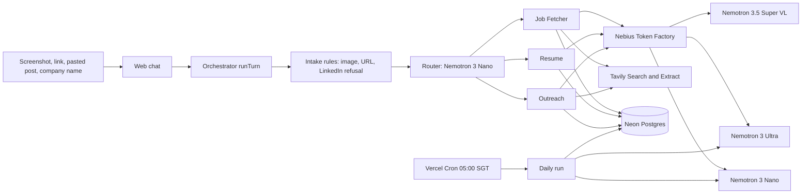

# Job Hunt OS: a private job-hunt assistant on NVIDIA Nemotron + Nebius Token Factory

Drop any job signal you find (a screenshot, a link, a pasted post, a company name) into one chat. Three Nemotron experts on Nebius Token Factory turn it into a scored lead, a one-page resume checked against your master, and a referral draft with a cited contact. Nothing leaves without your tap.

- Demo: `<DEMO_URL>`
- Video (under 3 min): `<VIDEO_URL>`
- Login: password in the Devpost testing instructions

## Why

I am an international MSc student in Singapore. A normal week is 12 hours of class, 16 hours at a part-time job and 8 to 10 hours of research. Job posts reach me while I scroll: a recruiter's post, a friend's screenshot, a careers page someone links in a group chat.

Turning one of those into a proper application takes four steps:

1. Read the full job description, which usually lives somewhere else.
2. Check fit honestly: visa, location, seniority, deadline, real skill gaps.
3. Write a one-page resume tailored to that role, with no invented facts or numbers.
4. Find a real person at the company to ask for a referral, and write a message they will read.

That takes about an hour per role, so most signals die in the camera roll. Job Hunt OS does steps 1 to 4 in one chat turn each and leaves only the decisions to you.

Usage so far: [X] postings collected and [Y] scored since Oct 23, 2026.

## What

- **One chat, any input.** Paste a screenshot, a job URL, a post's text, or just a company name.
- **A router and three experts.** The router reads the message and picks one expert to run. The other likely next steps appear as one-tap buttons.
  - **Job Fetcher**: turns a signal into a lead, finds the real job description, scores it against your profile with hard gates (A1 to A5), lists your top roles for today, searches one company's open roles.
  - **Resume**: drafts a one-page resume for one job from your master resume, then checks every claim and number against the master in code before it renders.
  - **Outreach**: finds one real person on a public page, proves the quote it relies on is on that page, and drafts a referral email plus a 200-character note.
- **A daily run.** Every morning at 05:00 SGT it collects new postings from 6 company boards, Nano triages up to 10, and Ultra re-judges the top 2.
- **Drafts only.** Email goes to Gmail as a draft. LinkedIn notes are text you copy. Applications are yours to submit.

## How it uses NVIDIA Nemotron on Nebius Token Factory

Every model call goes through one file, `src/server/nebius.ts`, to Nebius Token Factory. No other model provider is used.

| Call | Model | Why this size |
| --- | --- | --- |
| Router (intent + confidence) | Nemotron 3 Nano | Runs on every message; needs to be fast and cheap |
| Lead extraction from pasted text or a page | Nemotron 3 Nano | Structured JSON from short text |
| Daily triage of new postings | Nemotron 3 Nano | Many jobs, a rough score is enough to rank |
| Self-check of outreach drafts | Nemotron 3 Nano | A second read against a fixed checklist |
| Screenshot of a post | Nemotron 3.5 Super VL | Only model in the set that reads images |
| Single-job judge (gates, score, gaps) | Nemotron 3 Ultra | The decision you act on; worth the reasoning |
| Daily re-judge of the top postings | Nemotron 3 Ultra | Only the few jobs Nano ranked highest |
| Resume drafting | Nemotron 3 Ultra | Long structured output that must stay faithful to the master |
| Outreach draft | Nemotron 3 Ultra | Tone and specificity matter for a cold ask |

**Nano to Ultra cascade.** The daily run scores every new posting with Nano, then sends only the best 2 to Ultra. The chat shows both scores ("Nano 71, Ultra 78") so you can see where the larger model changed its mind.

**Per-step trace.** Each chat turn streams its steps as they run: expert, model, milliseconds, tokens in and out, and USD cost. Every call is also written to the `runs` table.

**USD caps.** Prices per model live in `src/core/models.ts`. Before each call the app sums today's and all-time spend:

- At 60% of the daily cap, saver mode maps Ultra steps to Nano and shows a banner.
- At the daily cap (`LLM_DAILY_USD_CAP`, default $1) or the total cap (`LLM_TOTAL_USD_CAP`, default $15), no model call is made. The chat answers with a banner and a link to the demo video.

### Where Token Factory accelerated our workflow

- One OpenAI-compatible endpoint serves all three model sizes. Choosing a model per step is a role name (`fast`, `vision`, `reason`) mapped to a model ID in env, so moving a step from Ultra to Nano is a config change with no code change.
- Saver mode depends on this: it swaps the model ID for a role at runtime, and the request shape stays the same.
- Measured per flow (median of [N] runs):

| Flow | Calls | Latency | Cost |
| --- | --- | --- | --- |
| Screenshot to scored lead | [n] | [s] | $[x] |
| Tailored resume | [n] | [s] | $[x] |
| Referral draft | [n] | [s] | $[x] |
| Daily run (6 boards) | [n] | [s] | $[x] |

## Tavily

Tavily Search and Extract do all live web work: finding the full job description behind a post, listing a company's open roles, and reading public team or speaker pages to find a contact. `linkedin.com` and `lnkd.in` are always in `exclude_domains`, and any LinkedIn URL is dropped in code before an Extract request. Job aggregators and social sites are excluded too, so results come from the company or its applicant tracking system.

## Architecture



### What each expert sees

| Expert | Sees | Never sees |
| --- | --- | --- |
| Router | Your message, the intake result, short summaries of the last 4 turns, the last job you worked on | Your master resume, profile, contacts, drafts |
| Job Fetcher | The scoring rubric (gates A1 to A5), your profile, your preference rules, your last 10 skip reasons, your Today list | Your master resume, contacts, drafts |
| Resume | Your master resume, the one job, its judged gaps, your guidance for this draft | Contacts, drafts, other jobs |
| Outreach | Your 5-line outreach summary, the one job (description up to 3,000 characters), known contacts at that company, the person you named | Your full master resume, scores, other jobs |

The same lists are shown in the app on the `/memory` page.

## Safety and privacy

- **Taps only.** Nothing outward (email, LinkedIn, application) happens without a signed tap from you.
- **Gmail drafts only.** The app saves a draft to your Gmail. You press Send in Gmail.
- **Never LinkedIn.** No code fetches linkedin.com. A LinkedIn link in chat gets "send a screenshot or paste the text" and no network call.
- **Untrusted text.** Job posts, web pages and screenshots are data. Every system prompt says so and tells the model to ignore instructions inside them.
- **Demo masking.** With `DEMO_MODE=1` your phone and email are masked on resumes, sending is disabled, and worker and bot routes return 404. The master resume is never returned by any route.
- **Spend caps.** Daily and total USD caps for models, and a daily cap for Tavily calls (`TAVILY_DAILY_CAP`).

## Quickstart

Requirements: Node 22, a Postgres database (Neon works), a Nebius Token Factory API key, a Tavily API key.

```bash
cp .env.example .env.local      # fill DATABASE_URL, NEBIUS_API_KEY, TAVILY_API_KEY, SIGNING_SECRET, DEMO_PASSWORD
npm install
npm run db:migrate
npm run db:seed                 # sources, profile, preferences from seed/
npm run demo:seed -- --master "Master Resume.md" --yes
npm run dev                     # http://localhost:3000
```

`demo:seed` reads `.env.demo` first if present, prints only the database host, refuses to write without `--yes`, stores your master resume, runs the daily Nemotron pass once and prints the LLM spend. Add `--no-daily` to skip the model calls.

Deploy on Vercel: import the repo, set the same env vars plus `CRON_SECRET`, and enable Fluid Compute. `vercel.json` schedules `/api/cron/daily` at 21:00 UTC (05:00 SGT); the route rejects requests without `Authorization: Bearer $CRON_SECRET`.

## Tests

```bash
npm test
```

Tests use fakes for Nemotron and Tavily (`tests/fakes.ts`) and never call Nebius or Tavily. Postgres integration tests run against a real schema when `PGHOST`, `PGPORT` and `PGUSER` are set, and skip otherwise. CI runs typecheck, tests and `next build` on every push.

## Built during the submission period

The project started on Oct 23, 2026 (see the first commits). This branch adds:

- Nemotron on Nebius Token Factory for every model call, with model roles, fallbacks, cost tracking and USD caps
- The router and the three experts (Job Fetcher, Resume, Outreach)
- Tavily Search and Extract, with LinkedIn always excluded
- The web chat with a live per-step trace and spend footer
- The daily Nemotron run on Vercel Cron (Nano triage, Ultra re-judge)
- Demo privacy: masking, disabled sending, closed internal routes

## License

MIT. See [LICENSE](LICENSE).
